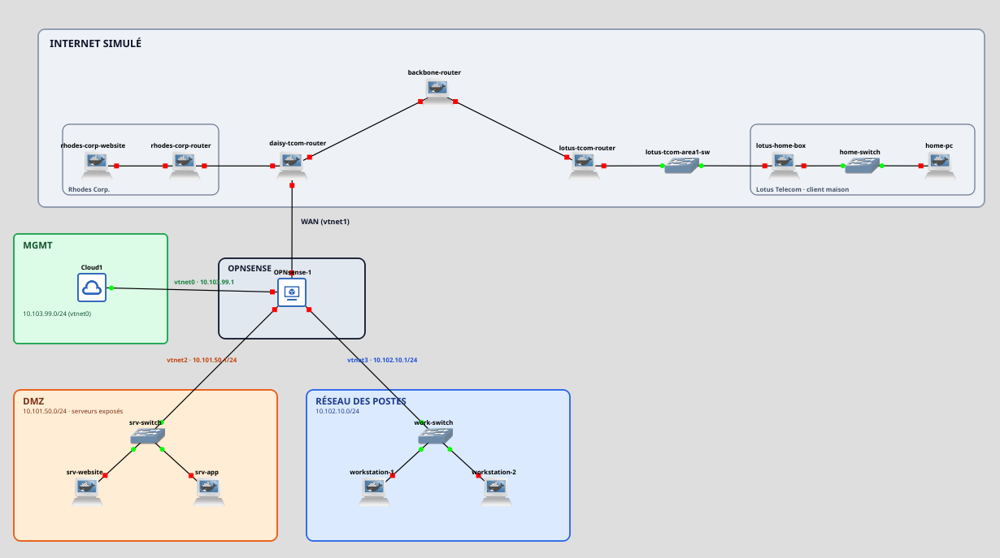

# Mini-Internet GNS3 : pare-feu OPNsense et DMZ

Projet d'apprentissage en cybersécurité (Blue Team). Dans un réseau d'entreprise simulé sous GNS3, le routeur Linux (`iptables`) de l'entreprise fictive **Clover Corp.** est remplacé par un pare-feu **OPNsense**. Les serveurs exposés sont placés dans une **DMZ**, la politique de filtrage est durcie, et les résultats sont vérifiés par des tests avec les journaux du pare-feu comme preuves.

Le rapport complet, avec les captures commentées, est dans [`rapport-opnsense-dmz.pdf`](rapport-opnsense-dmz.pdf).



## Objectif

Le routeur d'origine autorisait presque tout le trafic sortant, ne journalisait pas les blocages et s'administrait depuis sa console. L'objectif est de :

- remplacer ce routeur par OPNsense ;
- isoler les serveurs exposés dans une DMZ ;
- limiter les sorties au web et réserver l'administration à un réseau dédié ;
- journaliser les blocages et prouver chaque amélioration par un test.

## Architecture

OPNsense est une machine virtuelle QEMU à quatre interfaces, une par zone.

| Zone | Interface | Réseau | Rôle |
|---|---|---|---|
| WAN | `vtnet1` | `198.51.100.123/29` (passerelle `.121`) | Lien vers l'Internet simulé |
| DMZ | `vtnet2` | `10.101.50.0/24` | `srv-website` (`.10`) et `srv-app` (`.20`) |
| USERS | `vtnet3` | `10.102.10.0/24` | Postes de travail, DHCP `.100` à `.200` |
| MGMT | `vtnet0` | `10.103.99.0/24` | Administration depuis mon PC (`tap0`) |

## Ce qui change entre la v1 et la v2

| Sujet | v1 (iptables) | v2 (OPNsense) | Risque réduit |
|---|---|---|---|
| Sortie des serveurs | Tout autorisé | TCP 80/443 seulement | Shell inverse, exfiltration |
| Sortie des postes | Tout autorisé | TCP 80/443 et ICMP | Moindre privilège |
| Serveurs vers postes | Refusé | Refusé et journalisé | Rebond après compromission |
| Ping depuis Internet | Réponse | Pas de réponse | Reconnaissance |
| Administration | Console du routeur | Interface web limitée à MGMT | Prise de contrôle du pare-feu |
| Refus final | Implicite | Règle explicite avec log | Traçabilité |

## Tests réalisés

Un timeout signifie que le pare-feu a jeté le paquet. Chaque blocage est confirmé dans *Firewall > Log Files > Live View*.

| Test | Depuis | Commande | Attendu | Résultat |
|---|---|---|---|---|
| T01 | poste | `curl http://10.101.50.10` | Page web (autorisé) | Conforme |
| T05 | poste | `curl -k https://10.103.99.1` | Bloqué + log | Conforme (règle « Postes n'administrent pas le FW ») |
| T06 | poste | `curl -k -m 3 https://10.102.10.1` | Timeout | Conforme |
| T07 | srv-website | `ping` vers un poste | Bloqué + log | Conforme (règle « Anti-rebond vers les postes ») |
| T10 | srv-website | `curl -m 3 http://192.0.2.150:4444` | Timeout | Conforme (blocage en entrée de la DMZ) |

**Non testés :** l'accès au site Rhodes, le DNAT et les accès depuis Internet, car la liaison avec l'Internet simulé ne fonctionnait pas.

## Limites

- Le NAT et les échanges avec l'extérieur n'ont pas été validés (liaison WAN indisponible).
- Les tests ont été faits manuellement et les journaux sont lus à la main.
- Certaines règles n'ont pas de description, ce qui rend le champ « Label » vide dans certains journaux (par exemple pour le test T10).
- Pas de détection d'intrusion (IDS/IPS) ni de supervision centralisée (SIEM).

## Pistes d'amélioration

Réparer la liaison WAN pour valider le DNAT, ajouter Suricata, centraliser les journaux, passer à des VLANs 802.1Q avec un réseau invité, et renforcer l'administration (compte nominatif, double authentification).

## Compétences mises en œuvre

Configuration d'un pare-feu (OPNsense), segmentation réseau et DMZ, filtrage sortant (moindre privilège), analyse de journaux, méthode de test et de preuve, diagnostic sous Linux, virtualisation (GNS3, QEMU/KVM).

## Contenu du dépôt

```
.
├── README.md
├── rapport-opnsense-dmz.pdf     Rapport complet avec captures commentées
├── images/
│   └── topologie-gns3.png       Topologie GNS3 du projet
└── scripts/
    └── lab-up.sh                Recrée l'interface tap0 pour accéder à OPNsense
```

Le script `lab-up.sh` se lance avec `sudo ./scripts/lab-up.sh` avant de démarrer le nœud Cloud dans GNS3.

## Avertissement

Tout le travail est réalisé dans un laboratoire isolé. Ne pas reproduire ces tests contre des systèmes qui ne t'appartiennent pas. L'image OPNsense, les disques virtuels et la configuration exportée (`config.xml`) ne sont pas publiés : ils contiennent des éléments sensibles ou volumineux.
